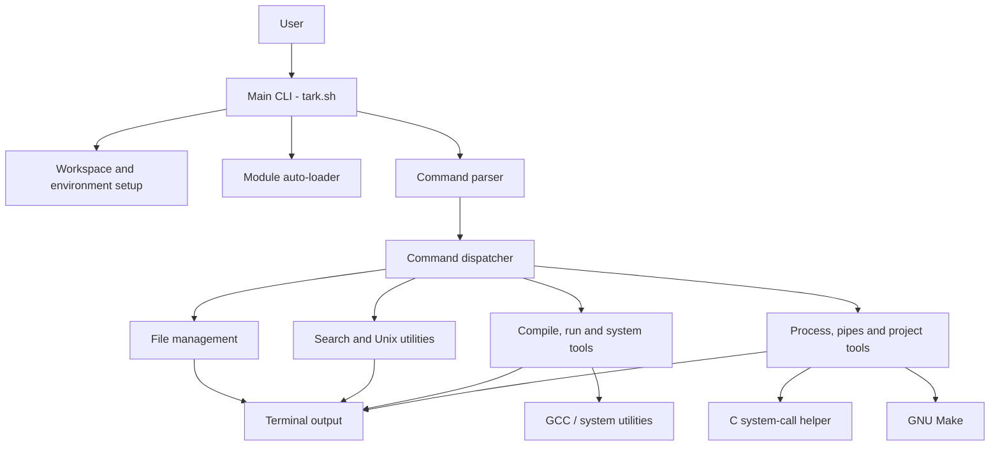
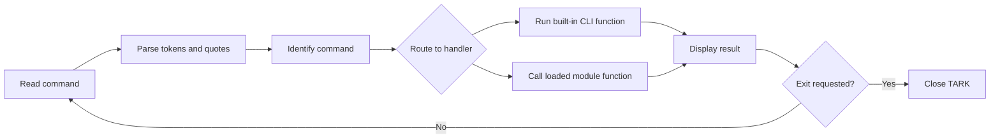

# TARK — Unix-Based Mini IDE

> A modular, terminal-based mini IDE built with **Bash and C** for Ubuntu/Linux. TARK brings everyday file operations, Unix utilities, C compilation, process handling, pipes, and multi-file project builds into one interactive command-line workspace.


## Overview

TARK (Terminal-based Unix IDE) is an educational mini development environment designed to demonstrate how a modular command-line application can bring together shell scripting, Unix utilities, compilation workflows, and operating-system concepts.

The main interface is `tark.sh`. It initializes the workspace, loads the modules, reads user commands, parses quoted arguments, and dispatches each command to the appropriate feature. Individual features live in separate Bash modules, while a small C helper demonstrates lower-level Unix system calls for process creation and I/O redirection.

## Architecture



### Command lifecycle



## Features

### Interactive CLI and workspace
- Menu-driven interface with an interactive prompt.
- Command parsing with support for single- and double-quoted arguments.
- Case-insensitive command names and command aliases.
- Automatic loading of shell modules from `modules/*.sh`.
- Workspace isolation; by default, user files are stored in `workspace/`.
- `status`, `help`, `menu`, `exit`, and one-command mode (`-c`).

### File management
- Create empty files so users can write their own code.
- Open files with line-numbered terminal output.
- Edit files using an available terminal editor, with a built-in fallback editor.
- Save a backup or save a copy, delete files with confirmation, and list workspace contents.
- Optional file-management submenu.

### Unix utilities
- Search text in files, with optional case-insensitive matching.
- Find files by name/pattern.
- Count lines, sort file contents, display the first or last lines, and show file contents.
- Run ordinary shell commands through the `!` command prefix.

### Compile, execute, and system information
- Compile and run C programs using GCC.
- Display system information and file permissions.
- Change file permissions and list running processes.

### Unix process and I/O demonstrations
A small C helper demonstrates selected Unix system calls:
- `fork()` — create a child process.
- `exec()` — replace the child process image with a command interpreter.
- `waitpid()` — wait for the child and collect its exit status.
- `pipe()` — create a communication channel between processes.
- `dup2()` — redirect standard input/output through file descriptors.
- `open()` — open files for redirection.

TARK exposes a two-command pipeline and single-command input/output redirection. It is a learning-focused implementation, not a complete replacement for a Unix shell.

### Multi-file C projects and build reports
- `make init` generates a sample multi-file C project and Makefile.
- `make` / `make all` builds C source files from `src/` into `build/app`.
- `make test` runs the generated sample test.
- `make clean` removes generated build output.
- `report` displays the latest Makefile build/test log; timestamped logs are kept under `.tark/reports/`.

## Tech stack

| Technology | Role |
|---|---|
| Bash | Main CLI, command parsing, dispatch, modules, and workflows |
| C | Unix system-call helper for process and file-descriptor operations |
| GCC | C compilation |
| GNU Make | Multi-file project build automation |
| Coreutils, grep, findutils | Unix file and text utilities |

## Getting started

### Requirements

- Ubuntu or another Debian-based Linux distribution
- Bash
- GCC
- GNU Make
- Standard command-line utilities (`coreutils`, `grep`, `findutils`)
- Nano is optional; TARK includes a basic fallback editor

### 1. Clone the repository

```bash
git clone <YOUR_GITHUB_REPOSITORY_URL>
cd TARK
```

Replace `<YOUR_GITHUB_REPOSITORY_URL>` with the URL of your GitHub repository. If the repository folder has a different name, `cd` into that folder instead.

### 2. Install dependencies

```bash
sudo apt update
sudo apt install -y bash gcc make nano coreutils findutils grep util-linux
```

Or run the included setup script:

```bash
chmod +x ubuntu_setup.sh
sudo bash ubuntu_setup.sh
```

### 3. Start TARK

```bash
chmod +x tark.sh
./tark.sh
```

### 4. Optional: use a custom workspace

```bash
TARK_WORKSPACE="$HOME/tark-work" ./tark.sh
```

## Command reference

| Command | What it does |
|---|---|
| `help` | Show available commands |
| `status` | Show workspace and loaded module status |
| `create <file>` | Create an empty file in the workspace |
| `open <file>` | Open/display a workspace file and select it as current |
| `edit [file]` | Edit the selected file or a specified file |
| `save [copy-name]` | Save a backup or copy of the current file |
| `delete <file>` | Delete a file after confirmation |
| `ls` | List workspace files |
| `search <word> [file] [-i]` | Search file contents |
| `find <pattern> [folder]` | Find matching files |
| `count [file]` | Count lines in a file |
| `sort [file] [-r]` | Sort file contents |
| `head [file] [n]` / `tail [file] [n]` | Display the first/last lines |
| `show [file]` | Display file contents |
| `!<command>` | Run a Unix shell command |
| `compile <file>` | Compile a C source file |
| `run <file> [args]` | Compile/run a C program using the execution module |
| `sysinfo` | Display system information |
| `perms <file>` / `chmod <file> <mode>` | View/change permissions |
| `process` | List processes |
| `process run "<command>"` | Run a child process and wait for it |
| `pipes pipe "<cmd1>" "<cmd2>"` | Connect two commands with a pipe |
| `pipes input <file> "<command>"` | Redirect a file to command input |
| `pipes output <file> "<command>"` | Redirect command output to a file |
| `pipes append <file> "<command>"` | Append command output to a file |
| `make init` | Generate the sample multi-file C project |
| `make` / `make test` / `make clean` | Build, test, or clean the sample project |
| `report` | Show the latest build/test report |
| `exit` | Exit TARK |

You can also execute one command without entering the interactive interface:

```bash
./tark.sh --help
./tark.sh --version
./tark.sh -c "status"
```

## Project structure

```text
TARK/
├── tark.sh                      # Main CLI, parser, dispatcher and main loop
├── ubuntu_setup.sh              # Debian/Ubuntu dependency installer
├── test_cli.sh                  # Main CLI regression tests
├── test_integration.sh          # Module integration smoke tests
├── test_ubuntu_features.sh      # Process, pipe, Makefile and report tests
├── modules/
│   ├── search.sh                # Search and find functionality
│   ├── utilities.sh             # Text and file utilities
│   ├── file_management.sh       # File-management submenu
│   ├── execution.sh             # Compile/run and system utilities
│   ├── integration_adapters.sh  # Connects CLI hooks to module APIs
│   ├── project_tools.sh         # Process, pipes, Makefile and report commands
│   └── tark_system.c            # Unix system-call helper
└── docs/
    ├── MODULE_TEMPLATE.sh       # Template for adding a module
    └── SEARCH_UTILITIES_README.md
```

## Run the tests

Run from the repository root:

```bash
bash test_cli.sh
bash test_integration.sh
bash test_ubuntu_features.sh
```

The test scripts use temporary workspaces for their checks. The integration and feature tests require the relevant system tools (including GCC and Make).

## Team contributions

This project was developed collaboratively. The main responsibilities were divided as follows:
## My Contribution

I was responsible for developing the **Main Command-Line Interface (CLI)** of TARK using Bash scripting.

My contributions include:

- **Main CLI Development:** Designed and implemented the central command-line interface and interactive menu system.
- **Command Parsing:** Developed the command parser to interpret user inputs and handle arguments, including filenames containing spaces.
- **Command Dispatching:** Implemented the dispatcher to route user commands to their respective functions and modules.
- **Module Auto-Loading:** Developed functionality to automatically load shell modules using Bash `source`.
- **Workspace Management:** Implemented workspace initialization and environment variable configuration.
- **File Operations:** Developed commands for creating, opening, editing, saving, deleting, and listing files.
- **Main Interactive Loop:** Implemented the continuous input-processing loop for user interaction.
- **System Integration:** Connected the individual modules through the main CLI and implemented basic validation and error handling.

My work focused on building the central control structure of TARK, allowing users to access its different functionalities through a unified command-line environment.


The process/pipeline C helper and Makefile/report tooling are included as integrated project features.

## Design notes and current limitations

- TARK is a terminal-based mini IDE; the separate React desktop mock-up is not integrated into this runnable CLI project.
- The C helper is compiled on first use into the workspace's `.tark/bin/` directory. GCC is therefore needed for those features.
- The pipeline implementation supports two commands; it is not a full shell parser or job-control system.
- `pipes input` and `pipes output` support single-command redirection.
- `make init` does not overwrite an existing Makefile. Its generated Makefile expects C sources under `src/` and headers under `include/`.
- `report` displays the latest Makefile build/test log. It is not a code-coverage tool or a full testing framework.
- File commands operate within TARK's workspace and validate paths; external-file editing/compilation is not documented as a supported workflow in this version.

## Future improvements

- Optional language-specific starter templates instead of automatic source-code insertion.
- Broader external-file support with safe path handling.
- More flexible pipeline composition and shell parsing.
- Additional language support and richer editor integration.
- Expanded automated tests and documentation.

## License

No license file is included yet. Add a license before presenting the project as open source; choose one that matches your team's intentions and permissions.
