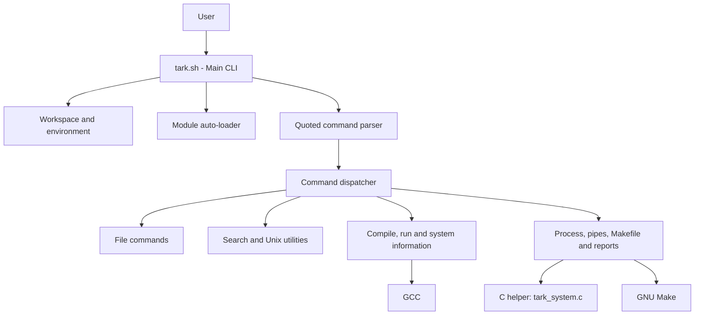

# TARK Architecture

## High-level architecture

## Request flow

1. `main()` prepares the workspace and loads modules.
2. `main_loop()` reads a command from the user.
3. `_cli_parse()` tokenizes the command and handles quoted arguments.
4. `dispatch()` identifies the command and routes it to a built-in handler or module function.
5. The selected feature performs its operation and reports the result in the terminal.

## Extension model

The CLI sources shell files found in `modules/*.sh`. A module can expose functions that the dispatcher or an integration adapter calls. This keeps feature implementations separate from the main command loop.
